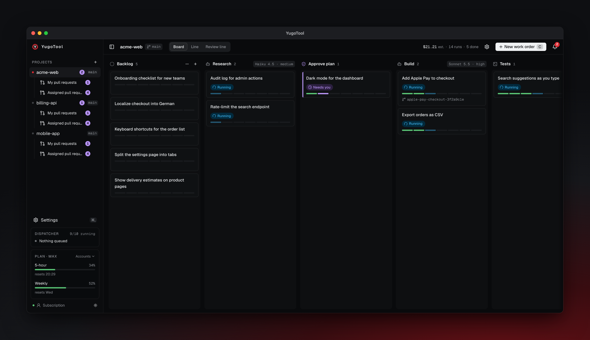
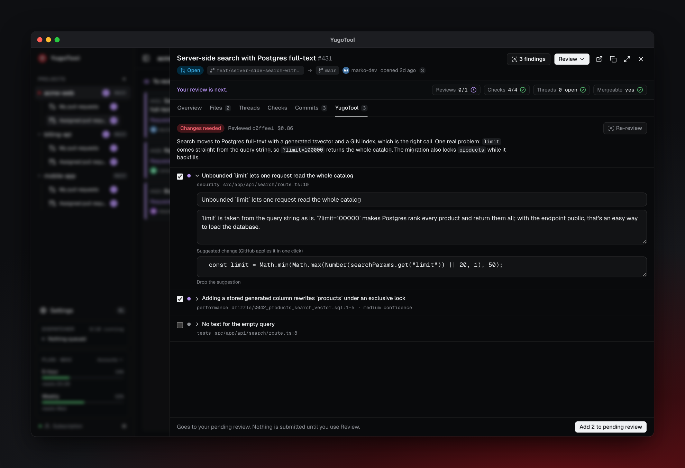
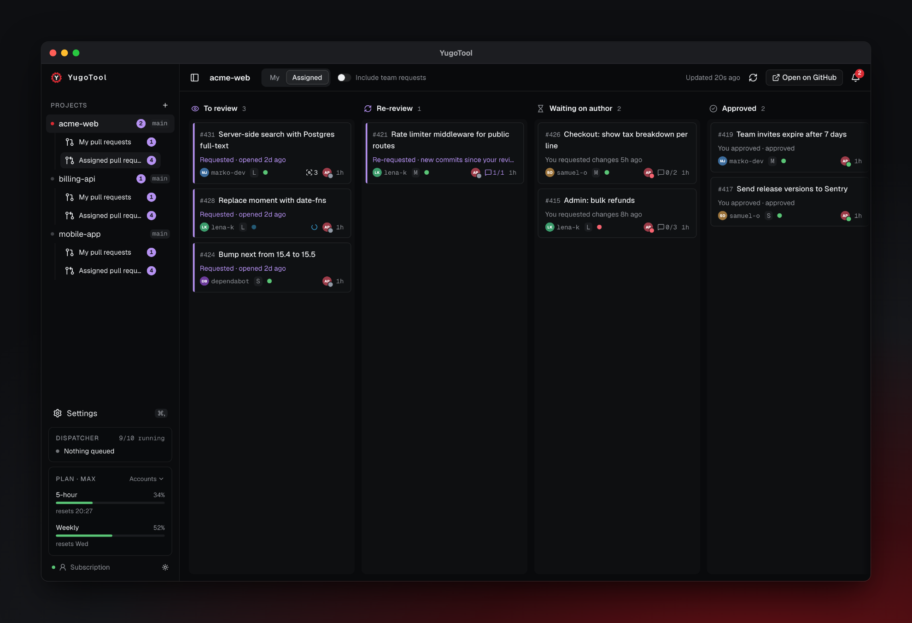
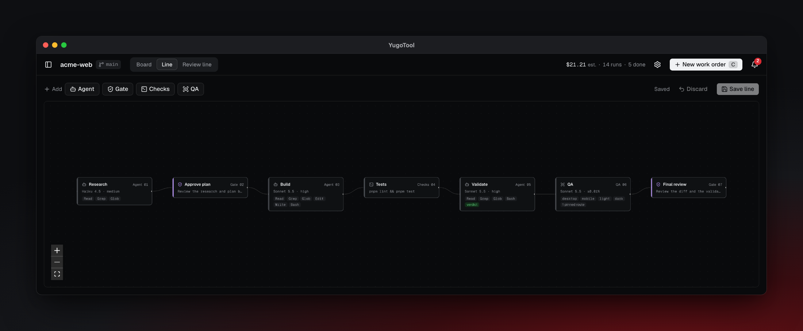
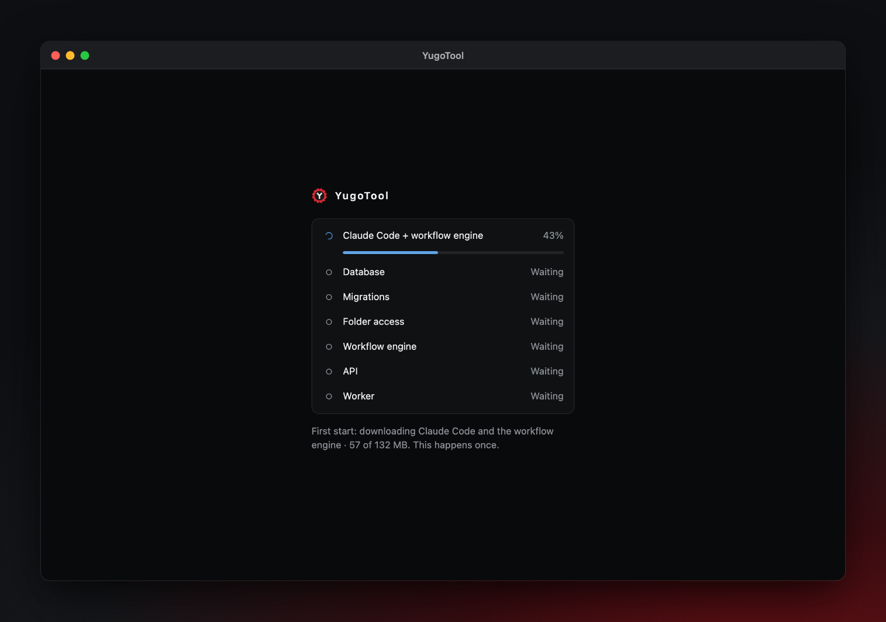
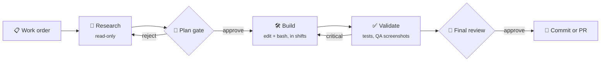
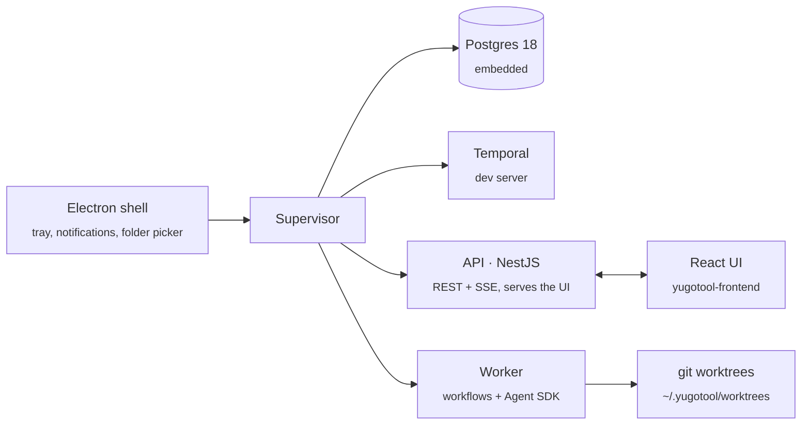

<div align="center">


# YugoTool

**A local software factory for Claude Code.**<br />
Drop a work order on a board. An assembly line of agents researches, builds, tests and reviews it in its own git worktree, stops at your quality gates, and delivers a commit or a pull request.

[](LICENSE)
[](#install)
[](#your-code-stays-on-your-mac)
[](#contributing)
<br />
[](https://docs.claude.com/en/docs/agent-sdk/overview)
[](https://temporal.io)
[](https://nestjs.com)
[](https://www.postgresql.org)
[](https://www.electronjs.org)
[](https://www.typescriptlang.org)

[Features](#features) · [How it works](#how-it-works) · [Install](#install) · [Development](#development) · [Frontend repo](https://github.com/BojanRatkovic/yugotool-frontend)

<br />

<picture>
  <source media="(prefers-color-scheme: light)" srcset="docs/screenshots/board-light.png" />
  
</picture>

</div>

## Why

Claude Code is great at one task in one terminal. Real work is many tasks, each needing research first, a human "yes" before code is written, tests, a review, and a clean branch at the end.

YugoTool turns that routine into a **production line** you can see. Every work order gets its own worktree, its own agent sessions and its own durable run. You only step in at the gates: approve the plan, look at the before/after screenshots, merge the PR.

## Features

|                                  |                                                                                                                                                                           |
| -------------------------------- | ------------------------------------------------------------------------------------------------------------------------------------------------------------------------- |
| 🏭 **Assembly line of agents**   | Research → plan gate → build → validate → final review. Each station is a Claude Agent SDK session with its own role, model, tools and prompt. Edit the line on a canvas. |
| 🚦 **Quality gates**             | Runs pause where a human should decide. Approve, reject, or request changes with a comment. The tray and notifications tell you when something needs you.                 |
| 🌳 **One worktree per run**      | Agents never touch your checkout. Every run builds on a fresh `yugotool/<slug>` branch from `origin/<base>`, so several work orders can run side by side.                 |
| ⏱️ **Durable runs**              | Runs are Temporal workflows: close the laptop, restart the app, and a run picks up where it stopped. Long stations work in **shifts** and hand off their context on disk. |
| 🧪 **QA that looks at your app** | A QA station starts your app, clicks through the changed routes and shows before/after screenshots, judged against the work order.                                        |
| 🚀 **Delivery**                  | A local commit, or a pushed branch with a pull request (`gh`), followed by its CI result.                                                                                 |
| 🔍 **PR review**                 | Run a review on any pull request, yours or a teammate's. Findings go into your pending GitHub review; a re-review checks what was fixed.                                  |
| 📚 **Knowledge & hubs**          | Point planning stations at your team's docs. Work hubs hold several repos on one board, and the repo is chosen per work order.                                            |
| 👥 **Claude accounts**           | Several Claude logins or API keys, one per project, with a live plan-usage meter so a full account only pauses its own projects.                                          |
| 🩺 **Doctor**                    | Checks Claude, git, `gh`, the database, Temporal and the worker, and says how to fix each.                                                                                |

<details>
<summary><b>More screenshots</b></summary>
<br />

|                                                                                                     |                                                                                                            |
| --------------------------------------------------------------------------------------------------- | ---------------------------------------------------------------------------------------------------------- |
|                  |  |
| **A run in shifts**: the station stepper, context and task progress, handoffs and cost per station. | **A quality gate**: approve and open the PR, request changes or reject, with the diff and QA right there.  |
|        |                                  |
| **PR review**: findings with one-click suggestions, added to your pending GitHub review.            | **Pull requests**: what to review, re-review, or wait on, per project.                                     |
|                                        |                             |
| **The line**: stations and gates; add, remove and configure them.                                   | **First start**: Claude Code and the workflow engine download once, with progress.                         |

</details>

## How it works



Under the hood it is one desktop app with a small process supervisor:



- **API** (`apps/api`): NestJS HTTP API with server-sent events. Every state change publishes an `invalidate` event (pg `NOTIFY` → SSE), so every open window refetches.
- **Worker** (`apps/worker`): a Temporal worker. The `workOrderRun` workflow drives the line; activities run Agent SDK sessions, git, QA captures and delivery.
- **Supervisor** (`apps/supervisor`): starts Postgres → migrations → Temporal → API → worker in order, health-checks them and restarts what crashes.
- **Desktop** (`apps/desktop`): the Electron app around all of it. On first start it downloads Claude Code and the Temporal CLI (checksummed) instead of shipping them, so the dmg stays at ~150 MB.

### Your code stays on your Mac

There is no YugoTool server. The database, runs, logs and worktrees live in `~/.yugotool`. Your code goes only where Claude Code sends it, and to your git remote when you ask for a pull request.

## Install

YugoTool runs on macOS (Apple silicon or Intel) and needs a Claude subscription or an Anthropic API key.

Build the app:

```bash
git clone https://github.com/BojanRatkovic/yugotool-backend.git
git clone https://github.com/BojanRatkovic/yugotool-frontend.git
(cd yugotool-frontend && pnpm install && pnpm build)
cd yugotool-backend && pnpm install && pnpm build
cd apps/desktop && pnpm dist          # → release/YugoTool-<version>-<arch>.dmg
```

Open the dmg and drag **YugoTool** to Applications. The first start downloads Claude Code and the workflow engine once.

> [!NOTE]
> Builds are ad-hoc signed until there is a Developer ID release. macOS asks once for access to the folder your repos are in (Desktop, Documents…). The loading screen says when it is waiting for you.

Prefer a browser? Run the same stack without Electron and open http://127.0.0.1:4810:

```bash
node apps/supervisor/dist/cli.js start     # status / stop from another shell
```

## Development

Requirements: **Node 24**, **pnpm 10**, the [`temporal` CLI](https://docs.temporal.io/cli), Postgres on `localhost:5432`, and Claude Code logged in (or `ANTHROPIC_API_KEY`). Optional: `gh` for pull requests, Playwright Chromium for QA.

```bash
pnpm install && pnpm build
pnpm dev:temporal                         # Temporal dev server, UI on :8233
pnpm db:migrate                           # creates the `yugotool` database
pnpm dev                                  # API + worker + packages in watch mode
(cd ../yugotool-frontend && pnpm dev)     # UI on http://localhost:4800
```

Open **Settings → Doctor** first: it checks everything YugoTool needs and tells you how to fix what is missing.

### Repository map

| Path                 | What it is                                                                                              |
| -------------------- | ------------------------------------------------------------------------------------------------------- |
| `apps/api`           | NestJS API + SSE: projects, lines, work orders, runs, PRs, settings, Doctor. Swagger at `/docs` in dev. |
| `apps/worker`        | Temporal worker: the `workOrderRun` workflow, Agent SDK activities, worktree runner, QA and delivery.   |
| `apps/supervisor`    | `yugotool start \| status \| stop`: runs and watches every service; logs to `~/.yugotool/logs`.         |
| `apps/desktop`       | Electron shell, packaging scripts (`stage.mjs`, `dist.mjs`) and the app icon.                           |
| `packages/contracts` | Zod schemas and types shared by API, worker and (mirrored) the frontend.                                |
| `packages/db`        | Drizzle schema, migrations, pg client.                                                                  |
| `packages/notify`    | Desktop, Slack and Telegram notifications.                                                              |
| `packages/skills`    | Finds the Claude Code skills a station may load (`/` autocomplete in prompts).                          |

### Configuration

The defaults work out of the box. These are the knobs:

| Variable                                      | Default               | What it does                                                            |
| --------------------------------------------- | --------------------- | ----------------------------------------------------------------------- |
| `YUGOTOOL_HOME`                               | `~/.yugotool`         | Data folder: database, logs, worktrees, runtime.                        |
| `YUGOTOOL_API_PORT`                           | `4810`                | API and UI port (moves to a free one if taken).                         |
| `YUGOTOOL_PG_PORT` · `YUGOTOOL_TEMPORAL_PORT` | `4832` · `4833`       | Embedded Postgres and Temporal.                                         |
| `REPOS_ROOT`                                  | `~/Desktop/Developer` | Where the New project picker looks for repos (also in Settings).        |
| `ANTHROPIC_API_KEY`                           | –                     | Bill agents to an API key instead of a Claude login (also in Settings). |
| `DATABASE_URL` · `TEMPORAL_ADDRESS`           | local defaults        | For `pnpm dev` against your own services.                               |

## Contributing

Issues and pull requests are welcome. Before you open a PR, run the quality gate:

```bash
pnpm lint && pnpm format:check && pnpm typecheck && pnpm test && pnpm build
```

A few house rules:

- Zod everywhere: nestjs-zod DTOs come from the contract schemas.
- Services own transactions; repositories take an `Executor`. Errors are `DomainError` subclasses.
- Creates take a client-generated `id` and are idempotent.
- Agent activities are never retried automatically (they cost money); bookkeeping activities are.
- Workflow code stays deterministic: no I/O, `Date`, `Math.random` or Node APIs in `apps/worker/src/workflows/**`.
- Conventional Commits, in English. More in [`CLAUDE.md`](CLAUDE.md).

## Roadmap

- [ ] Signed and notarized releases with auto-update
- [ ] Linux and Windows builds
- [ ] Cloud runners for heavy lines

## Acknowledgements

The name nods to **Jugoalat**, the Novi Sad toolmaker (1935–2017) whose milling cutters and drills were in every Yugoslav workshop. Its slogan was _"Nema zanata bez Jugoalata"_: there is no trade without Jugoalat. The logo is one of those cutters.

YugoTool is built on [Claude Code](https://claude.com/claude-code) and the [Claude Agent SDK](https://docs.claude.com/en/docs/agent-sdk/overview), [Temporal](https://temporal.io), [NestJS](https://nestjs.com), [Drizzle](https://orm.drizzle.team), [Electron](https://www.electronjs.org) and [embedded-postgres](https://github.com/leinelissen/embedded-postgres).

## License

[MIT](LICENSE) © 2026 Bojan Ratković
